# Software Development Process

This document describes the AI-based software development process used in this project.

## Introduction

Artificial intelligence can significantly increase productivity in software development.
AI coding assistants (AICA) can take on the role of a developer and implement tasks on their own.
To use an AICA effectively in a project, it must be embedded in a development process. This
document describes a process that has proven itself in practice, and how it is implemented in
this project.

### Terms

| Term                  | Meaning                                                                                  |
|-----------------------|------------------------------------------------------------------------------------------|
| AICA                  | AI coding assistant, e.g. Claude Code, the AI software agent working in this repository |
| AI task (AI issue)    | A task for the AICA, stored as a file in `aitasks/`                                      |
| HP issue              | A task for human persons (HP), e.g. a user story or requirement in a tracker like Jira   |
| PO                    | Product owner, who selects the requirements to implement                                 |
| AI docs               | Documentation for the AICA: the skills in `skills/` and `AGENTS.md` / `CLAUDE.md`        |

## Prerequisites

### AI task management (AI issue tracker)

For each task, a compact, human-readable document is created that serves as a shared source of
information for humans and AI software agents. It describes the purpose of the task, its
functional and technical content including acceptance criteria, and its dependencies on other
tasks, together with organizational information such as the status and its history.

Because the task description is plain text, it can be reviewed and adapted not only by the AI
but also by humans. The AICA can create, review and improve these descriptions itself, based on
the available context. Task management thereby becomes a central tool that supports both
planning and implementation.

Completed tasks remain relevant: from them, the AICA can derive why certain decisions were made
and which assumptions applied at an earlier point in time. Therefore, completed tasks are kept
and not deleted.

**In this project:**

- Each AI task is a Markdown file in `aitasks/`, named `TASK-<NNNN>-<short-name>.md`.
- Task numbers show the order in which tasks should be done.
- A task contains: ID, short description, status, optional external link, dependencies,
  motivation, task description, acceptance criteria and a history of all status changes.
- The status is one of `open`, `in-work`, `waiting`, `done` and `aborted`.
- Tasks are created and listed with `scripts/tasks.sh` (`scripts/tasks.sh help` shows all
  commands). The task template is defined in that script.

### Human task management (HP issue tracker)

For planning, humans can either use the AI task management directly or use a separate task
management system such as Jira. In the latter case, the two are linked, so that planning,
prioritization and implementation remain traceable.

**In this project:** an AI task refers to its HP issue via the field **External link**
(e.g. the URL of a Jira issue).

### Skills for implementing tasks

To carry out the development process reliably, the AICA needs clearly defined skills. Skills
encapsulate recurring activities and ensure that tasks are created, improved and implemented
according to uniform rules. All skills apply the project-specific guidelines, e.g. a
test-driven approach, wireframes for GUI requirements, and clear completion conditions such as
a successful build, a passing test suite and met static quality metrics.

| Skill            | Purpose                                                                                       | Status in this project |
|------------------|-----------------------------------------------------------------------------------------------|------------------------|
| `add-task`       | Creates a new AI task from the information and wishes of a human. The AICA can add project-specific guidelines to the task automatically. | available (`skills/add-task/`) |
| `improve-task`   | Improves an existing AI task based on the current state of the project and the AICA's knowledge, so that it is functionally complete, technically feasible and unambiguous. It checks whether the task is still valid, updates it if not, and looks for other errors and possible improvements. | available (`skills/improve-task/`) |
| `implement-task` | Implements an AI task. Before starting, it checks the task against the Definition of Ready (`doc/aiTaskDefinitionOfReady.md`). After a successful implementation, it checks the acceptance criteria and the Definition of Done (`doc/aiTaskDefinitionOfDone.md`) and marks the task as `done`, documenting the completion of the work step. | available (`skills/implement-task/`) |

Skills are stored in `skills/`; `.claude/skills` links to it, so Claude Code registers them
natively.

### Technical project documentation

The technical project documentation must at least describe how to set up the system for
development and which architecture decisions the project is based on.

If individual documents become too large, they should be split into smaller pieces of
knowledge. This wiki principle makes it easier for both humans and the AICA to find relevant
information quickly and to reuse it selectively.

**In this project:** all documentation is stored in `doc/`, e.g.:

- `doc/developerInfrastructure.md`: the tools installed on every developer's computer
- `doc/architecture.md`: the software architecture and its rationale
- `doc/buildAndTest.md`: the commands to build, test, check and run the application
- `doc/qualityobjectives.md`: the quality objectives based on ISO/IEC 25010
- `doc/context.md`: the context and constraints of the application
- `doc/qameasures.md`: the automated QA measures derived from the quality objectives
- `doc/aiTaskDefinitionOfReady.md` / `doc/aiTaskDefinitionOfDone.md`: the criteria a task must
  meet before work starts and before it is done

The domain, problems and features of the application are described in the central `README.md`.

### AICA documentation

The AICA documentation describes where central information can be found in the project. It
serves as the AICA's point of orientation, so that it reliably understands the project
structure, working rules, documentation sources and relevant entry points.

**In this project:** the AICA documentation is `AGENTS.md`, which is read by all common AI coding
assistants. `CLAUDE.md` imports it, so Claude Code loads the same information.

## The development process

The diagram shows the development process from the perspective of the developer working with
the AICA. It consists of two independent flows: the implementation of a requirement, and
the regular maintenance of the documentation, the AI docs and the code quality.

The original BPMN model is stored in `doc/swdevproc.bpmn`.

```mermaid
flowchart TD
    subgraph REQ["Implementing a requirement"]
        reqStart(["User story / requirement (HP issue)<br/>is selected by the PO for implementation"])
        createTasks["Create AI tasks for the requirement<br/>(add-task)"]

        subgraph LOOP["Implement the AI tasks"]
            loopStart(("Start"))
            selectTask["Select an AI task for implementation"]
            improveTask["Review and improve the AI task<br/>(improve-task)"]
            implementTask["Implement the AI task<br/>(implement-task)"]
            reviewResults["Review the results"]
            meetsReq{"Results meet<br/>the requirement?"}
            collaborate["Work with the AICA<br/>to complete the task"]
            allDone{"All AI tasks of the<br/>HP issue done?"}
            reqDone(["HP requirement implemented"])

            newNeed>"Need for a new AI task identified"]
            addTask["Create a new AI task<br/>(add-task)"]
            addDone(("End"))
        end
    end

    reqStart --> createTasks --> loopStart --> selectTask --> improveTask --> implementTask --> reviewResults --> meetsReq
    meetsReq -- No --> collaborate --> reviewResults
    meetsReq -- Yes --> allDone
    allDone -- No --> selectTask
    allDone -- Yes --> reqDone
    newNeed --> addTask --> addDone

    subgraph MAINT["Regular maintenance"]
        timer(["Periodically"])
        fork{"+"}
        reviewDocs["Review the technical<br/>project documentation"]
        optimizeAiDocs["Optimize the AI docs<br/>(skills and AGENTS.md)"]
        codeQa["Perform QA measures<br/>on the code"]
        join{"+"}
        maintDone(("End"))
    end

    timer --> fork
    fork --> reviewDocs & optimizeAiDocs & codeQa
    reviewDocs & optimizeAiDocs & codeQa --> join
    join --> maintDone
```

Legend: rounded boxes are events (start and end), rectangles are activities, diamonds are
decisions, and diamonds marked `+` split into or join parallel activities. The flag-shaped node
is an event that can occur at any time during the implementation of the AI tasks.

### Implementing a requirement

The process starts when the product owner selects a user story or requirement (HP issue) for
implementation. The developer first breaks this requirement down into one or more AI tasks in
`aitasks/`, using the skill `add-task`. The AI tasks are then processed one after another in a
subprocess:

1. The developer selects an AI task for implementation. Tasks whose dependencies are not yet
   `done` cannot be selected; `scripts/tasks.sh list -deps open` shows the open tasks with their
   dependencies.
2. The developer reviews the AI task with the skill `improve-task` and improves it if necessary,
   so that it matches the current state of the project and can be implemented unambiguously.
3. The AICA implements the AI task with the skill `implement-task`. It checks the Definition
   of Ready and sets the status to `in-work` when it starts, and sets it to `done` when all
   acceptance criteria and the Definition of Done are met, recording each change in the
   task's history.
4. The developer reviews the results. If they do not meet the requirement, the developer works
   directly with the AICA to complete the task and then reviews the results again. This loop
   repeats until the requirement is met.
5. If not all AI tasks of the HP issue are done, the developer selects the next AI task
   (step 1). Once all AI tasks are done, the HP requirement is implemented and the process ends.

If it turns out during the subprocess that an additional AI task is needed, the developer
creates it with `add-task` without interrupting the current work. The new AI task is then
selected and implemented in a later iteration of the loop.

### Regular maintenance

Independently of individual requirements, the developer regularly performs three activities in
parallel:

- Review the technical project documentation in `doc/`.
- Optimize the AI docs: the skills in `skills/` and `AGENTS.md`.
- Perform quality assurance measures on the code.

This keeps the foundations the AICA works with up to date and reliable.
